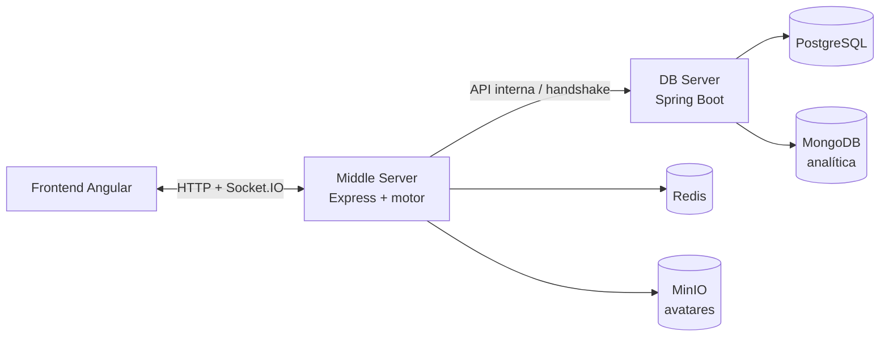

<div align="center">

# ⚡ Viking Clan Wars · Middle Server

### El motor que mantiene viva la guerra.

**Reglas de juego, estado de partidas y comunicación en tiempo real.**

[](https://nodejs.org/)
[](https://expressjs.com/)
[](https://socket.io/)

[Proyecto completo](https://github.com/agb4455/tfm) · [Cliente web](https://github.com/agb4455/ProyectoIntermodularDamFrontend) · [DB Server](https://github.com/agb4455/ProyectoIntermodularDamBackend)

</div>

---

## 🛡️ El corazón del juego

El **Middle Server** es el motor autoritativo de Viking Clan Wars. Expone la API HTTP y los canales Socket.IO que utiliza el frontend, valida las acciones de los jugadores y mantiene el estado de las partidas activas. También coordina autenticación, caché/sesiones y persistencia con los servicios de datos.

## 🧭 Flujo entre servicios



## ⚔️ Responsabilidades

- **Motor de juego:** acciones, combate, investigación, fases, victoria y avance temporal con *Time Wheel*.
- **Tiempo real:** salas y eventos Socket.IO para sincronizar las partidas.
- **API HTTP:** autenticación, partidas, perfil, estadísticas y administración.
- **Seguridad:** validación de tokens, sanitización y límites de peticiones.
- **Integraciones:** handshake con DB Server, Redis para sesiones/estado auxiliar y MinIO para avatares.
- **Sincronización:** carga y persistencia periódica del estado de las partidas.

## 🛠️ Tecnologías

Node.js 22 · Express 5 · Socket.IO 4 · Redis · MinIO/S3 · JWT · Jest · Pino

## 🚀 Desarrollo local

### Requisitos

- Node.js 22 y npm
- Redis, DB Server y MinIO accesibles para probar el flujo completo

### Instalar y arrancar

```bash
npm install
npm run dev
```

El servidor escucha en el puerto `3000` por defecto. Para arrancarlo sin recarga automática:

```bash
npm start
```

La forma recomendada de levantar el sistema completo es desde el [orquestador](https://github.com/agb4455/tfm): ejecuta su script de preparación y después `docker compose -f docker-compose.dev.yml up --build`.

## ⚙️ Configuración

El servidor carga variables desde `.env`. Las variables principales son:

| Variable | Uso | Valor local predeterminado |
|---|---|---|
| `PORT` | Puerto HTTP y Socket.IO | `3000` |
| `JWT_SECRET` | Firma de tokens de sesión | No definido; configurar |
| `DB_SERVER_URL` | URL del DB Server | `http://localhost:8080` |
| `DB_HANDSHAKE_SECRET` | Secreto compartido para handshake interno | No definido; configurar |
| `REDIS_URL` | Conexión a Redis | `redis://localhost:6379` |
| `MINIO_ENDPOINT` | Endpoint S3/MinIO | `http://localhost:9000` |
| `MINIO_ACCESS_KEY` / `MINIO_SECRET_KEY` | Credenciales de MinIO | No definidas |
| `MINIO_BUCKET_AVATARS` | Bucket para avatares | `avatars` |
| `MINIO_PUBLIC_BASE_URL` | URL pública del bucket | `http://localhost:9000/avatars` |

El orquestador inyecta la configuración de red adecuada a cada contenedor. En local, crea un `.env` con secretos propios y endpoints que apunten a tus servicios. **No reutilices valores de ejemplo en producción.**

## 🧪 Pruebas y utilidades

```bash
npm test
npm run verify-clans
```

`npm test` ejecuta la suite Jest. `npm run verify-clans` ayuda a comprobar que los datos de clanes están sincronizados con el frontend.

## 🗂️ Mapa del código

```text
src/
├── config/       # Configuración y carga de datos del juego
├── db/           # Conectores a DB Server, Redis y MinIO
├── game/
│   ├── actions/  # Acciones de jugador
│   ├── engine/   # Time Wheel, combate, investigación y victoria
│   └── state/    # Almacén y sincronización de partidas
├── http/         # Rutas y controladores REST
├── middleware/   # Autenticación, rate limiting y sanitización
├── models/       # Modelos de juego
├── socket/       # Eventos Socket.IO
└── utils/        # Logging y utilidades
```

## 🔗 Ecosistema

- [Orquestador y despliegue](https://github.com/agb4455/tfm)
- [Frontend Angular](https://github.com/agb4455/ProyectoIntermodularDamFrontend)
- [DB Server](https://github.com/agb4455/ProyectoIntermodularDamBackend)

## 📄 Licencia

Consulta [`LICENSE`](./LICENSE) para las condiciones de uso del proyecto.

<div align="center">

**Un mundo persistente necesita un motor que nunca pierda el pulso.**

</div>
